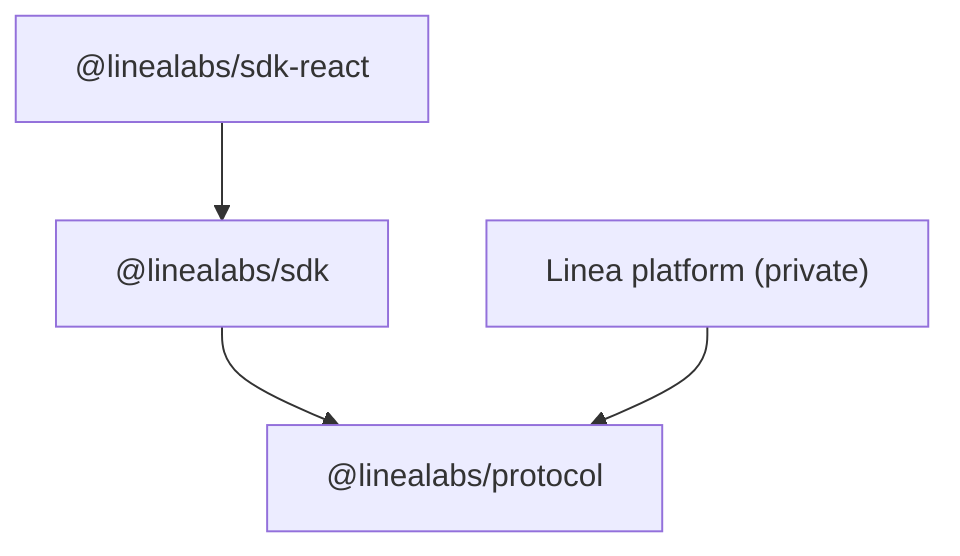

## Repositories

| Repository                                              | Holds                                                 |
| ------------------------------------------------------- | ----------------------------------------------------- |
| [`linea-org/linea`](https://github.com/linea-org/linea) | Protocol, SDKs, examples, and generated API reference |
| [`linea-org/docs`](https://github.com/linea-org/docs)   | This documentation site                               |

The platform (the web app, API, workers, and mobile app) is developed in private
repositories.

## Open packages

| Package                | Owns                                                               |
| ---------------------- | ------------------------------------------------------------------ |
| `@linealabs/protocol`  | Public operations, schemas, events, and stable errors              |
| `@linealabs/sdk`       | Server, browser, and native clients, and webhook verification      |
| `@linealabs/sdk-react` | Headless React hooks for End-User apps, and the CopilotKit adapter |

<Callout type="warn" title="Not released yet">
  None of them is on npm, and they can change without notice.
</Callout>

## Dependency rule

The platform and both SDKs use the same protocol, so a request or response shape
is defined once.
