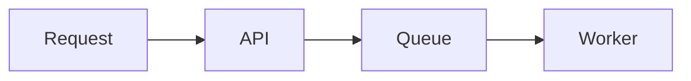

The SDKs and the protocol are open source in
[linea-org/linea](https://github.com/linea-org/linea), and this site in
[linea-org/docs](https://github.com/linea-org/docs). The platform itself (the
dashboard, API, and workers) is developed privately. To report a problem with it,
open an [issue](https://github.com/linea-org/linea/issues).

## Understand the system

An Operator authors a versioned Workflow in a workspace. An Application can
expose a Workflow Contract to its End Users, whose Conversations and Executions
remain isolated. Start with the
[architecture overview](./architecture/index.mdx) and
[execution flow](./architecture/execution-flow.mdx).

| Question                               | Start here                                                                              |
| -------------------------------------- | --------------------------------------------------------------------------------------- |
| Which repository or package owns this? | [Repository map](./architecture/repository-map.mdx)                                     |
| Which credential can call an endpoint? | [API overview](./api/index.mdx) and [trust boundaries](./security/trust-boundaries.mdx) |
| Why was a boundary chosen?             | [Architecture decisions](./decisions.mdx)                                               |

## Find the owning code

| Change                         | Start in             | Check alongside it                |
| ------------------------------ | -------------------- | --------------------------------- |
| Public operation or shape      | `packages/protocol`  | SDK method and the API reference  |
| Server, browser, or native SDK | `packages/sdk`       | Protocol and packed-package tests |
| React hooks or components      | `packages/sdk-react` | `packages/sdk` user client        |
| Example application            | `examples`           | The SDK it uses                   |

A new public operation also needs the platform to implement it, so open an issue
before starting one.

## Ship a focused change

Use one `feat/<slug>` or `fix/<slug>` branch per issue. Read the
[contribution guide](https://github.com/linea-org/linea/blob/main/.github/CONTRIBUTING.md),
and run its checks before opening a pull request:

```bash
pnpm format:check
pnpm check:contracts
pnpm build
pnpm lint
pnpm typecheck
pnpm test
pnpm test:pack
```

After changing a public operation, run `pnpm generate:contracts` and commit the
result.

## Contribute documentation

The docs site lives in its own repository,
[linea-org/docs](https://github.com/linea-org/docs), with its pages in
`content/docs`. The following steps run inside that repository.

## Add or edit a page

<Steps>

### Find the owning section

Architecture explains boundaries and flows, API explains public behavior,
Security explains threats and invariants, and Decisions preserves trade-offs.

### Write Markdown or MDX

Each page begins with a title and description:

```mdx
---
title: Durable executions
description: How Linea recovers workflow execution after interruption.
---
```

### Place the page in navigation

Add its filename to the nearest `meta.json`. Navigation order is explicit so a
new page does not appear in an arbitrary location.

### Preview and verify

```bash
pnpm dev
pnpm lint
pnpm typecheck
pnpm build
pnpm format:check
```

</Steps>

## Supported content

### Tables

GitHub-flavored Markdown tables render without custom components.

| Use                   | Prefer              |
| --------------------- | ------------------- |
| Exact mappings        | Table               |
| State or request flow | Mermaid diagram     |
| Ordered procedure     | `Steps` component   |
| Parallel alternatives | `Tabs` component    |
| Important caveat      | `Callout` component |

### Mermaid diagrams

Use fenced `mermaid` blocks. Keep node labels short and explain the important
invariants in prose below the diagram.

````md

````

### Tabs and callouts

<Tabs items={["pnpm", "npm"]}>
  <Tab value="pnpm">`pnpm dev`</Tab>
  <Tab value="npm">The repositories use pnpm; npm is not supported.</Tab>
</Tabs>

<Callout title="Document the why">
  Prefer contracts, boundaries, examples, and surprising constraints over a
  prose copy of implementation details visible in the source.
</Callout>

## Review expectations

- Update the docs when a public contract changes.
- Link to the source of truth instead of duplicating large schemas.
- Mark planned behavior clearly; do not describe it as available.
- Do not publish credentials, customer data, private endpoints, or exploit details.
- Keep diagrams editable as text whenever Mermaid can express them clearly.
