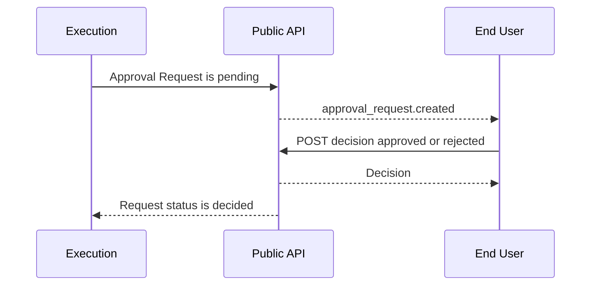

An Approval Request and its Decision are different resources. The request has `status` `pending`, `decided`, or `cancelled`. The Decision, once present, has `outcome` `approved` or `rejected` and `reason` `human` or `timeout`. `comment` may be null.

The request stores `executionId`, optional `conversationId`, `display` (`title`, optional `description`, optional string `details`), `version`, `requestedAt`, and optional `expiresAt`. A decided request keeps that Decision on the same object.

Only an End-User Session can submit the Decision. The operation returns `201`. A second Decision conflicts. Timeout is a `reason` on the Decision, not a separate write from the client.

An Action Intent is the proposed external operation. The pending list shows `operation`, `connectionId`, `executionId`, and the Approval Request id it depends on. Approving the request is `decide`. The pending list itself does not grant the side effect.

Connection uses record what happened later. `classification` is `read` or `side_effect`. `outcome` is `succeeded`, `failed`, `stale`, `rejected`, `cancelled`, or `outcome_unknown`.

Webhook envelopes for this flow use the types `approval_request.created`, `approval_request.decided`, `approval_request.cancelled`, `action_intent.executed`, and `action_intent.failed`. Connector audit facts use a longer set of names, including consent and intent lifecycle values. Those names are the `connectorAuditFactTypeSchema` enum in the protocol.

Who may review a shared Connection is an authority record: `assignReviewer` and `grantAccess` take an External Subject id. The hosted workspace has the same assignment in its Environment UI. A requester grant and a reviewer assignment are different records.
