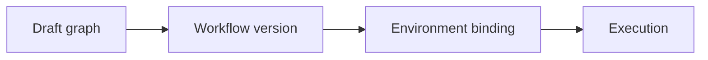

An Execution runs the version its Environment selects, not the latest published one.

The public binding schema stores that selection:

| Field                        | Role                                                      |
| ---------------------------- | --------------------------------------------------------- |
| `environmentId`              | The Environment                                           |
| `workflowId`                 | The Workflow                                              |
| `workflowVersionId`          | The version this Environment runs                         |
| `workflowContractRevisionId` | The Contract revision, with input and output JSON Schemas |
| `allowBackendStart`          | Whether an Environment key may start it                   |
| `allowEndUserStart`          | Whether an End-User Session may start it                  |
| `enabled`                    | Whether the binding is on                                 |

The registry has no operation that reads or writes this binding. You change it in the hosted workspace. A start that cannot use the binding returns `workflow_binding_not_found`, `workflow_binding_disabled`, `workflow_start_not_allowed`, or `workflow_binding_incompatible`.

`saveDraft` updates the working copy. `createVersion` stores a version and a `contentHash`. `publishedAt` on that version stays empty until the hosted workspace publishes it. `linea.workflows.run` starts the version bound to the dev Environment. `LineaEnvironmentClient.startExecution` starts the version bound to the Environment of the key, and can start an Agent by `agentId`.

A workspace execution record stores `workflowVersionId`, `environmentId`, and `environment` (`draft`, `dev`, or `production`). Read `workflowVersionId` to see which version that record ran. Conversation resources use `dev` and `production` only.

A Workflow Contract revision stores `revision`, `inputSchema`, and `outputSchema`. The start `input` is the JSON object you send. The public packages do not export a JSON Schema compiler.
