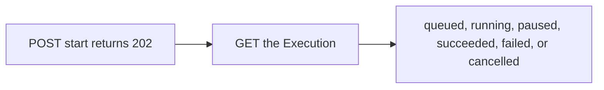

An Execution is one run. The public resource is `publicExecutionSchema`. The workspace client has a wider record, `workspaceExecutionSchema`, from `GET /v1/workspace/executions/{executionId}`. That wider route is not in the operation registry.

## Public fields

| Field                                   | Values                                                            |
| --------------------------------------- | ----------------------------------------------------------------- |
| `status`                                | `queued`, `running`, `paused`, `succeeded`, `failed`, `cancelled` |
| `output`                                | JSON value, or null                                               |
| `error`                                 | `{ code, message }`, or null                                      |
| `workflowId`                            | Set on a Workflow run. Null on an Agent run.                      |
| `agentId`                               | Set on an Agent run only                                          |
| `environmentId`                         | The Environment the run belongs to                                |
| `externalSubjectId`                     | The External Subject the run is for                               |
| `conversationId`                        | A Conversation id, or null                                        |
| `createdAt`, `startedAt`, `completedAt` | Timestamps. Start and completion are null until they happen.      |

`waitForExecution` treats `succeeded`, `failed`, and `cancelled` as finished. `queued`, `running`, and `paused` keep the poll waiting. The schema lists those statuses. It does not list which transitions the server allows. `cancelEnvironmentExecution` is the registered cancel call. It can return `execution_not_cancellable`.

## Steps

A Step is one node attempt on the workspace execution detail. The SDK type is `WorkspaceExecutionStep`. Fields include `nodeId`, `sequence`, `attempt`, `status` (`running`, `succeeded`, `failed`, `skipped`), `input`, `output`, `error`, `costMicros`, `tokensInput`, and `tokensOutput`.

The public Environment and End-User Execution resources do not include `steps`. Use the workspace client's `executions.get` when you need them. `costMicros` is a decimal string on both the execution and the step.

`nodeConfigs` on that detail is a map of node id to an open record. `waitingNodes` lists nodes the run is waiting on. `pausedAtNode` is the first of those.

## Failure

A failed public Execution sets `status` to `failed` and `error` to a code and message. The company app example shows End Users a general failure line. The same Execution is what a developer reads back with `getExecution`.

`input` on a start is limited to 64 KiB, depth 16, 2048 nodes, and collections of 256 entries. Larger input fails validation before a run is accepted.
