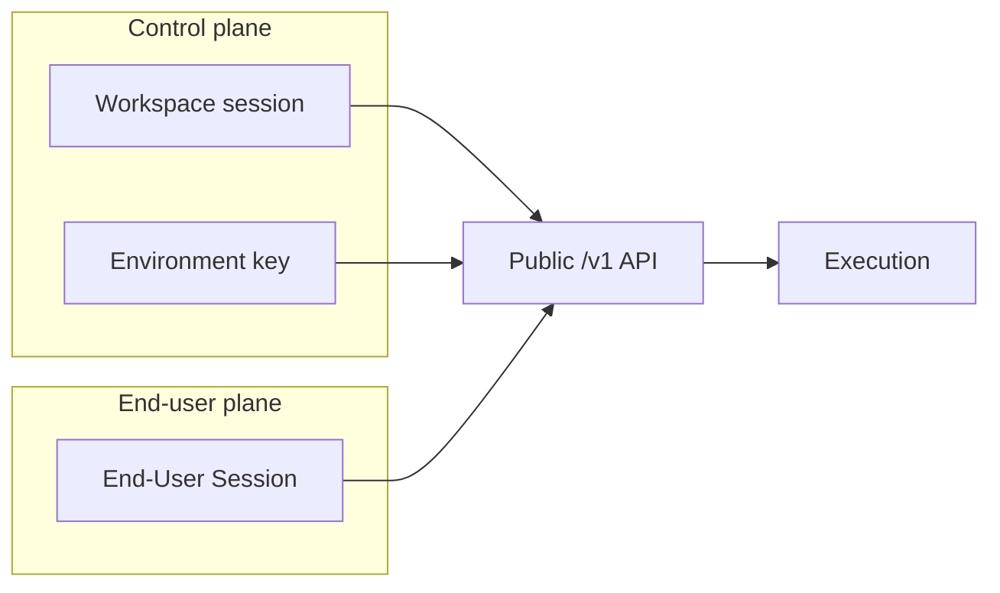
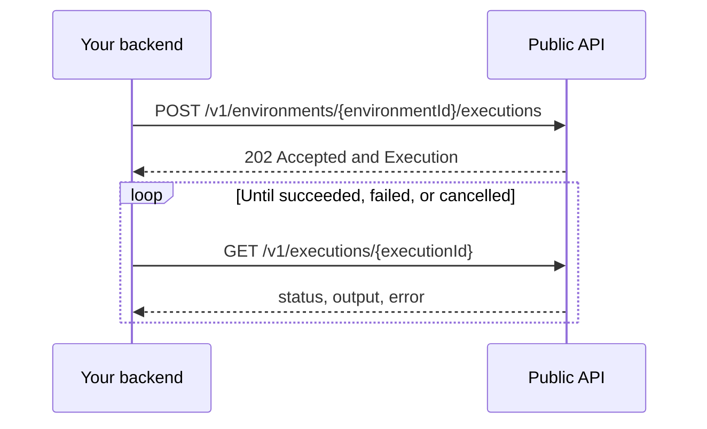

The protocol labels every registered operation with a plane: `control` or `end_user`.

The control plane is the set of operations a workspace session, a workspace key, or an Environment key calls. That includes shared Connections, regression cases, provisioning an External Subject, and starting an Execution for an Environment.

The end-user plane is the set of operations an End-User Session calls. That includes Conversations, messages, Workflow starts, Approval Decisions, personal Connections, and the event stream.

The runtime is the part that accepts a start and moves the Execution through its statuses. From the public API, the runtime is the Execution resource. You start it, then read it. The open repository does not include the process that performs the graph.

An Environment key starts either a Workflow or an Agent. An End-User Session starts a Workflow. Authoring the Agent, publishing a version, and binding that version to an Environment happen in the hosted workspace.

A `202` means the Execution was accepted. It does not mean the graph has finished. `paused` is a real status. Polling helpers keep waiting while the run is paused.

The same protocol package defines the schemas the SDK parses. A response that does not match the schema raises `LineaProtocolError` on the protocol clients.
