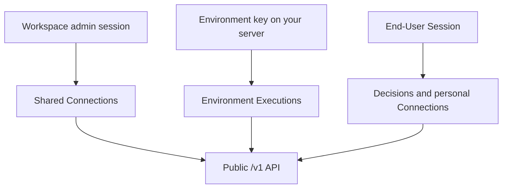

The public protocol uses separate credentials so a workspace backend, an Environment backend, and an End User do not share one token.

1. Environment keys and workspace keys are different prefixes and different clients.
2. An End-User Session is DPoP-bound. Copying the access token without the proof key does not satisfy the client.
3. `LineaUserClient` never accepts an API key. `Linea` and `LineaEnvironmentClient` are server clients.
4. A Decision is stored apart from the browser session that submitted it. The request remains addressable by id for the matching subject.
5. Provider credentials for a shared GitHub installation are sent on the admin operation (`privateKey` in the body). They are not returned on the public Connection projection. The Connection projection lists `provider`, `providerAccountId`, `accountLabel`, `status`, and `scopes`.
6. Report vulnerabilities to `contact@getlinea.app`. Follow the [security policy](https://github.com/linea-org/linea/blob/main/.github/SECURITY.md). Do not open a public issue for a vulnerability.

The hosted dashboard authenticates workspace members for authoring. That login is not one of the five registered `auth.kind` values. Pass a session cookie only to `LineaConnectionAdminClient`.

See [Trust boundaries](/docs/explanation/trust-boundaries) for the identity names, and [Authentication](/docs/reference/authentication) for headers.
