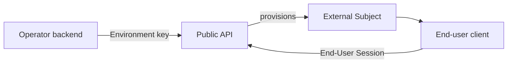

An Operator is the workspace side that authors Workflows and holds workspace credentials. An End User is represented by an External Subject. The subject is not a workspace member. Its status is `provisioned`, `verified`, `disabled`, or `erased`.

An Environment key acts for one Environment. It can provision a subject when it has `subjects:provision`. The provision body is `issuerSubject` (1 to 500 characters) and up to 20 metadata fields. Metadata values are strings up to 500 characters, finite numbers, booleans, or null. Metadata keys are 1 to 64 characters.

| Credential        | Can                                                       | Cannot                                                                     |
| ----------------- | --------------------------------------------------------- | -------------------------------------------------------------------------- |
| Environment key   | Call the environment operations its scopes allow          | Call End-User Decision or personal Connection operations                   |
| Workspace key     | Call registered audit and regression reads for its scopes | Stand in for an Environment key. The constructor rejects `lin_env_` values |
| Workspace session | Administer shared Connections and regression writes       | Act as an End-User Session                                                 |
| End-User Session  | Act for its `externalSubjectId` inside its Environment    | Call environment-key or workspace-key operations                           |

Keep Environment keys, workspace keys, GitHub App private keys, and session cookies on a server you control. A browser integration uses `LineaUserClient` and receives only the DPoP session that client stores.
