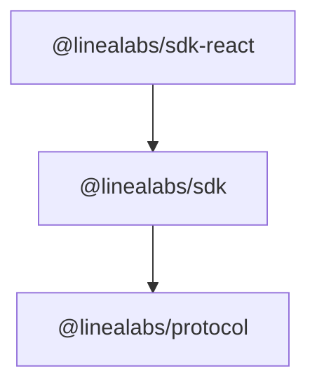

Linea is a runtime and control plane for production agents. Its SDKs and protocol are open source under Apache 2.0.

| Repository                                            | Visibility | License             | What it holds                                                                                                          |
| ----------------------------------------------------- | ---------- | ------------------- | ---------------------------------------------------------------------------------------------------------------------- |
| [linea-org/linea](https://github.com/linea-org/linea) | Public     | Apache-2.0          | Protocol, SDKs, and examples                                                                                           |
| [linea-org/docs](https://github.com/linea-org/docs)   | Public     | Apache-2.0          | This site, served at [docs.getlinea.app](https://docs.getlinea.app)                                                    |
| [linea-org/web](https://github.com/linea-org/web)     | Public     | All rights reserved | Marketing site. [www.getlinea.app](https://www.getlinea.app) is served from this repo. `getlinea.app` redirects there. |
| linea-org/platform                                    | Private    | All rights reserved | Hosted dashboard, API, and workers. Not documented here.                                                               |
| linea-org/mobile                                      | Private    | All rights reserved | Not documented here.                                                                                                   |

Code published in `linea-org/linea` before the repository split on 25 November 2026 stays under Apache-2.0.

## Public packages

| Package                | Owns                                                                |
| ---------------------- | ------------------------------------------------------------------- |
| `@linealabs/protocol`  | Registered operations, schemas, events, webhooks, and stable errors |
| `@linealabs/sdk`       | Server, browser, and native clients, and webhook verification       |
| `@linealabs/sdk-react` | React hooks and the CopilotKit adapter                              |
| `@linealabs/config`    | Shared lint and TypeScript config for the SDK repository            |

The hosted platform is a separate tree. These docs do not describe its internals. Where a task can only be done there, the how-to says so.
