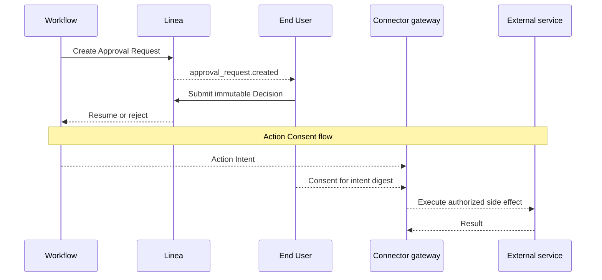

An Approval Request pauses an execution for a human decision. Action Consent
authorizes one specific external side effect, and the connector gateway
enforces it before the effect runs.

## Approval lifecycle

- The request is durable and owned by the approver identity.
- A browser session ending does not orphan the request.
- Approve and reject responses are immutable Decisions.
- Timeout and cancellation are explicit terminal outcomes.
- A decided request cannot accept a second Decision.

## Action consent

An Action Intent describes the target, operation, and relevant parameters before
the side effect occurs, and waits in `awaiting_consent`. Consent covers the
digest of that exact intent or an explicit policy broad enough to include it.
The connector gateway claims the intent and checks consent, the Connection, and
the requester and reviewer authority at the final side-effect boundary, and
fails closed if any of them was revoked.

This prevents a compromised or buggy workflow executor from turning approval for
one action into authority for a different action. After the claim, an intent
reports `succeeded`, `failed`, `stale`, or `outcome_unknown`; it never claims to
have been cancelled once it started.
